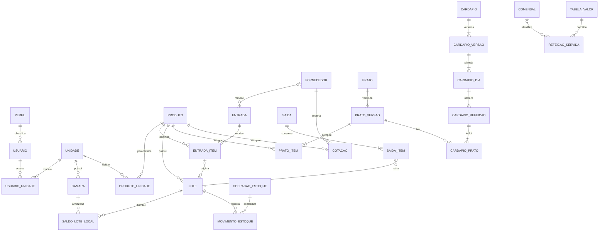

# DATA-001 — Nova modelagem do banco

**Fase B, proposta para revisão.** Data: 06/11/2026. Base de código: `ffb174b`. Modelagem refeita a partir do DRS, sem copiar o DDL de `legacy/` e sem aplicar alterações no Supabase. Nenhum objeto descrito neste documento já existe por efeito desta tarefa.

## Contrato e documentos

- [DRS](../requisitos/Requisitos_Software_Restaurantes_Populares_Joinville.md), seções 4, 6–15, refinamentos v1.2/v1.3 e adendo arquitetural.
- [Dicionário lógico e físico proposto](DICIONARIO.md).
- [Estados, transações e testes de estoque](TRANSACOES_ESTOQUE.md).
- [Identidade, permissões e acesso](../seguranca/SEC-001.md).
- [Plano](../planejamento/RECONSTRUCAO_SDD.md): desenho na B; migrations e testes na C2.

Os nomes e divisões de tabelas são decisões técnicas propostas. Não mudam prioridades ou adicionam módulos de compras/licitação/pagamento. Os relatórios RF-021–RF-030 são consultas sobre as entidades e não dez novas fontes de saldo.

## Modelo conceitual

O diagrama mostra relações de registros efetivos, não mínimos obrigatórios de rascunhos. Um rascunho pode ainda não ter itens. Lote de abertura tem origem em importação/inventário, não necessariamente em entrada comercial; itens recusados não criam lote. Os detalhes de origem estão no dicionário.

## Decisões propostas de escopo

1. Catálogos de medidas, categorias, produtos e fornecedores compartilhados; parâmetros de estoque por produto/unidade. Essa separação deriva do modelo conceitual do DRS. Alcance da edição global deve ser revisado antes das policies: vínculo a uma unidade não concede gestão de todas as unidades.
2. Pratos/fichas em catálogo compartilhado, com histórico imutável de versões, e cardápios estritamente por unidade. Acesso de escrita ao catálogo e eventual necessidade de autoria por unidade são pontos de revisão, sem ampliar a matriz do DRS.
3. Usuário de negócio vinculado ao UUID de `auth.users`; um perfil por usuário, como a relação N:1 da seção 13. Não criar múltiplos papéis por unidade ou novos perfis sem necessidade documentada.
4. Livro único de movimentos mais saldo por lote/local como projeção transacional. Somente operações confirmadas podem gravá-los; nenhum endpoint CRUD direto sobre saldo ou livro.
5. Histórico de consumo importado fica separado de movimentos reais. Não pode aumentar ou diminuir estoque. Abertura de saldo exige aprovação e gera livro.
6. Valores desconhecidos de doação são nulos, sem converter desconhecido em custo zero. Relatórios de valor/custo mostram incompletude; comparativo de preços exclui doações.
7. Atendimento segue a minimização do refinamento: código interno/perfil e contagens, sem duplicar CadÚnico. Conflito com CA-015 e a descrição antiga precisa de decisão antes de implementar o módulo.
8. Sem transferência entre restaurantes: RF-014 trata locais da mesma unidade. Transferência entre unidades continua fora do escopo atual.

## Cobertura de requisitos funcionais

| Fonte | Entidades/contratos propostos | Verificação planejada |
| --- | --- | --- |
| RF-001, RF-002, RF-003, RF-004 | unidade_medida, categoria, produto, produto_conversao, produto_unidade, fornecedor, produto_fornecedor | RN-001–003/013/019/026; CA-001 |
| RF-005, RF-006, RF-007, RF-008 | prato/versão/itens, unidade/calendário, parâmetros, câmaras, usuários/perfil/vínculo | CA-002/003/011; RF-008 sessão e provisionamento |
| RF-009, RF-010, RF-011 | cardápio/versionamento, previsão calculada, ajuste de estimativa, compras sugeridas derivadas | CA-003/004; nenhuma previsão movimenta saldo |
| RF-012, RF-013, RF-014, RF-015, RF-016, RF-017 | recebimento, saída/conferência, transferência, perda, inventário, livro/saldos/fechamento | CA-005–009/014/021–024/026 |
| RF-018, RF-019, RF-020 | comensal mínimo, tarifas vigentes, atendimento, fechamento de caixa, produção e sobras | CA-015, condicionado à conciliação de contrato |
| RF-021, RF-022, RF-023, RF-024, RF-025 | consultas de saldo/valor/perda/rastreio/consumo a partir do livro e documentos | CA-007/010/012/014; rastreio sem suposição de consumo teórico |
| RF-026, RF-027, RF-028, RF-029, RF-030 | previsto/realizado, validade, indicadores, alertas, auditoria restrita | CA-012/014; papel/unidade e exportações |
| RF-031, RF-032, RF-033, RF-034, RF-035 | custos calculados, nutrição informada, cotações versionadas, comparativo e alertas | CA-016/017/018/020 |
| RF-036, RF-037 | importação/linhas/histórico, amostras/descarte | CA-019/025; sem execução antecipada de prioridades futuras |

RNF-002/003/007/008/010 orientam acesso, segregação, minimização, trilha e atomicidade. RNF-004/005/006/009/011–015 permanecem critérios de operação, desempenho, UI e toolchain: não são satisfeitos pela existência deste modelo. CA-013 continua dependente de restauração real.

## Condições antes da C2

- Revisar modelo e contratos, resolver permissões contraditórias para o recorte e validar semântica de inventário concorrente.
- Confirmar por leitura identidade/ambiente e snapshot do schema conectado, sem usá-lo como base obrigatória do modelo novo.
- Definir ambiente isolado, versão exata de PostgreSQL/Supabase CLI, estratégia de migrations e dados fictícios. Validar CLI com `--help`: a documentação consultada informa mudança de comportamento na CLI v3; não copiar flags antigas.
- Implementar e testar uma fronteira de escrita que impeça bypass de regras por chamadas diretas ao Data API. RLS isoladamente não implementa workflow nem transações de múltiplas linhas.
- Registrar revisão por PR antes de considerar desenho aceito. Não há evidência de aprovação institucional ou prontidão para dados reais.

## Evidências e limites

Leitura textual do PDF original de 71 páginas, páginas 10, 11, 51 e 52, via pdfjs-dist 6.5.438 instalado apenas na pasta de ferramentas do usuário. SHA256 do PDF: `E45091B8D7A27AE1800248BE07B09573BBB3FB569995EC15221E44466EBBED45`. O extrator foi executado com sucesso após correção de sua finalização. A conferência foi textual, sem afirmar inspeção visual, e não altera o PDF nem o DRS. Os conflitos encontrados estão em SEC-001.

**Estado:** desenho proposto, sem SQL executável, migrations, policies ou testes de banco executados. O recorte de modelagem avança a fase B, mas não encerra FND-000 nem atinge FND_READY.

Verificação estrutural local: sete links relativos dos quatro documentos novos resolvidos; os 37 IDs RF aparecem explicitamente na cobertura; 56 entidades propostas no dicionário, sem nomes duplicados. Isso verifica organização/rastreabilidade, não executabilidade do schema, qualidade dos planos de consulta ou correção de autorização. A revisão de semântica e os testes PostgreSQL continuam necessários na etapa correspondente. Nenhum teste da aplicação foi reexecutado neste recorte exclusivamente documental.
