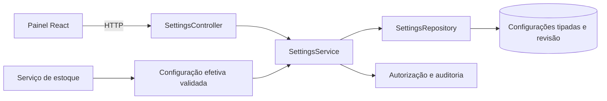

# CONFIG-001 — Painel de parâmetros e políticas operacionais

Data: 06/11/2026. **Direção definida pela responsável:** reduzir acoplamento por meio de parâmetros e ações configuráveis em um painel simples, inspirado na organização de um ERP, com baixa complexidade. **Estado deste recorte:** mapeamento e especificação; painel, endpoints e persistência ainda não implementados. Não depende de tecnologia ou integração com Protheus.

## O que já estava mapeado

| Fonte | Cobertura existente | Lacuna encontrada |
| --- | --- | --- |
| DRS RF-006/007/008 e seção 15.4 | Calendário/refeições, câmaras, motivos, limites, prazos, aprovação da saída e sessão | Não define uma tela completa nem contrato único de configuração |
| Dicionário DATA-001 | parametro_unidade, parametro_categoria_unidade, produto_unidade e tabela_valor | Faltam revisão/concorrência, leitura efetiva e ligação explícita dos aprovadores às ações |
| DOM-001/SEC-001 | Variações de aprovação/permissão identificadas | Estavam tratadas como decisões de regra única, sem mecanismo de configuração detalhado |
| Style Guide | Componentes e sete telas nomeadas | Não há frame nomeado Configurações; compor tela nova com componentes existentes, sem alterar o HTML mestre |
| Código | Worker de liveness, raiz React e contratos mínimos | Não há SettingsService, repository, API de configurações ou painel |

Assim, a parametrização estava **parcialmente prevista na documentação**, sem implementação integrada.

## Limite da parametrização

Configurar significa escolher entre comportamentos previamente especificados e testados. Não haverá linguagem de fórmulas, scripts no banco, plugins, motor genérico de workflow ou cadastro irrestrito de chaves arbitrárias. Um parâmetro novo continua exigindo contrato, código e teste.

Garantias obrigatórias não têm interruptor: isolamento entre unidades, bloqueio de saldo negativo, segregação entre autor e aprovador/conferente, trilha de auditoria, imutabilidade de movimentos e atomicidade. Também não expor opção que aceite lotes vencidos para consumo ou desligue autenticação. Desligar uma etapa opcional não pode desligar essas garantias.

Restrições explícitas da unidade permanecem validadas no servidor: no RP1, toda perda exige aprovação enquanto vigorar RN-020/CA-022. Não oferecer um checkbox que contradiga isso. A direção de parametrização não foi interpretada como revogação de todo o DRS.

## Catálogo inicial de opções

| Grupo / chave conceitual | Controle de interface | Escopo e valor inicial | Regra/integração |
| --- | --- | --- | --- |
| Saídas / modo | Seleção Prévia ou Posterior | Unidade; RP1 Posterior, conforme DRS | Salvar modo/revisão no documento; conferência nunca baixa duas vezes |
| Perdas / limite sem aprovação | Número com unidade explícita e auxílio | Unidade; RP1 zero | RP1 não aceita valor que dispense aprovação; esclarecer se limite é quantidade/valor antes de habilitar outra unidade |
| Aprovação / responsáveis por ação | Seleção de perfis elegíveis, titular e substituto opcional | Unidade/ação; ativação depende de configuração válida | Nutricionista/gestor conforme contrato da ação; vínculo ativo obrigatório; não conceder Admin universal |
| Cotações / perfis que lançam | Lista fechada de perfis | Catálogo global no modelo atual; sem conceder poderes locais sobre todo o catálogo implicitamente | Distinguir permissão de lançar da de aprovar; não duplicar regra de autorização em cada tela |
| Transferência / exige aprovação | Interruptor com indicação do efeito | Unidade; preset conservador proposto: ligada | Ligada exige aprovador distinto; desligada só altera a etapa de aprovação, preserva autorização de registro, unidade e débitos/créditos atômicos. Registrar exceção à RN-011 no contrato final |
| Inventário / política de contagem | Informação de política; seleção só quando houver alternativas implementadas | Primeiro recorte proposto: nova contagem se a referência mudou | Não anunciar reconciliação temporal como opção funcional antes de implementá-la/testá-la |
| Requisição rápida / habilitada | Interruptor | Unidade; habilitada no RP1 para RN-034/CA-024 | Desativação no RP1 depende de revisão da regra obrigatória; nas demais unidades, só oferecer se permitido pelo contrato |
| Requisição rápida / vínculo à refeição | Seleção na retirada ou na conciliação | Unidade; conciliação posterior proposta | Registrar retirada imediatamente; alocação posterior sem outro débito; cardinalidade de destino ainda deve ser definida |
| Planejamento / margem e FC | Percentual e campos do produto/ficha | Unidade/categoria; 5% e FC 1,00 no DRS | Preservar unidade e origem da configuração; previsão não movimenta saldo |
| Alertas / validade, divergência e preço | Dias e percentuais; toggles apenas para alertas opcionais | 7 dias; divergência saída/entrada 10%; variação cotação 15% | Obrigatoriedade M não pode ser desligada por preferência; e-mail opcional separado do alerta interno |
| Operação / calendário, refeições, inventário | Horários, dias, refeições e periodicidade | Unidade; valores do DRS 15.4 | Usar cadastros estruturados; não colocar grade de calendário em JSON genérico |
| Amostras / prazo | Número de horas | Unidade; 72 h | Prazo aplicado fica registrado na coleta; mudar parâmetro não reescreve amostras antigas |
| Custos / preço de referência | Menor cotação, último pago ou média dos lotes | Unidade; menor cotação com fallback último pago | Mostrar custo incompleto se faltar preço; não trocar desconhecido por zero |
| Atendimento / tarifas e modalidades | Tabela com vigência | Unidade/perfil/refeição | Gestão central conforme DRS; respeitar tetos/gratuidade; sem novos dados pessoais |
| Segurança / sessão | Minutos, dentro de limites aprovados | Global; padrão 30 minutos | Administração técnica; não exibir credenciais no painel; não permitir sessão ilimitada |

Os valores explicitamente citados pelo DRS são baseline. Demais presets estão identificados como propostas, sem ativação implícita. Não criar controles de desligamento para módulos/recursos sem necessidade operacional definida. Um recurso ainda não implementado deve aparecer como planejado, não como um toggle que promete habilitá-lo.

## Interface proposta

Entrada no menu **Configurações**, com o mesmo shell, tipografia, espaçamento, cores, campos e botões do Style Guide. Cabeçalho com **escopo Global ou Unidade**, unidade selecionada, revisão e situação de edição. Seção Global somente para quem possuir a permissão específica; não permitir alternar unidade apenas mudando um parâmetro na URL.

Abas curtas: **Operação**, **Aprovações e acesso**, **Alertas e planejamento** e **Histórico**. Na primeira entrega, mostrar apenas configurações do estoque e as políticas implementadas. Tarifas/calendário detalhado mantêm seus formulários específicos, acessíveis pelo painel, sem duplicar cadastros em dois lugares.

Cada campo mostra nome legível, valor, unidade, texto de ajuda, origem (padrão/unidade/categoria) e, se bloqueado, o motivo. Evitar códigos internos como única identificação. Booleanos usam interruptor; opções mutuamente exclusivas usam seleção; limites usam número/percentual com unidade. Política de inventário com um só modo implementado usa texto informativo, não um seletor fictício.

Fluxo: carregar → editar → **Revisar alterações** → resumo Antes/Depois + motivo → salvar atomicamente → sucesso com revisão nova. Botões **Cancelar** e **Restaurar padrão**; restaurar exige prévia e usa a mesma validação/permissão de salvar. Confirmar saída com alterações não salvas. Histórico é leitura com ator, instante, unidade, motivo e mudanças, sem dados de segredo.

Estados previstos: carregando, sem permissão, unidade inválida, erro ao carregar, erro por campo, nenhuma alteração, salvando, sucesso e conflito de revisão. Em conflito, preservar a edição local e mostrar diferenças para recarregar/reaplicar; não sobrescrever a configuração alheia. Não salvar silenciosamente enquanto a pessoa navega entre abas.

Este é desenho de fluxo, não uma tela validada por comparação visual. Não alterar o Style Guide mestre nem declarar WEB-001 concluída. Layout responsivo, foco/teclado, rótulos e mensagens sem depender só de cor são critérios da futura implementação.

## Arquitetura com baixo acoplamento

Em `packages/contracts`, definir DTOs/tipos públicos e validação de formato, sem importar React, cliente Supabase ou bibliotecas de Worker. `SettingsService` valida a combinação de opções e usa uma interface `SettingsRepository`; o adaptador de banco implementa essa interface. A View só conhece HTTP e DTOs. Serviço de estoque recebe configuração efetiva/contexto explicitamente no caso de uso; não lê flags globais nem consulta a tela.

Manter um único módulo pequeno de resolução de configuração e funções específicas para decisões, por exemplo: decidir modo de saída, se a operação exige aprovação e quais perfis são elegíveis. Não espalhar `if(unidade === RP1)` por controllers e componentes. Restrições da baseline da unidade pertencem à validação central da política, não ao JSX.

Separar **permissão de configurar**, **permissão de lançar** e **elegibilidade para aprovar**. Selecionar um aprovador não pode conceder acesso administrativo. Um usuário não pode editar sua elegibilidade e aprovar a própria operação. Políticas são verificadas no backend/banco, inclusive em chamada direta; esconder botões é apenas UX.

## Dados e contrato HTTP propostos

Manter `parametro_unidade` e `parametro_categoria_unidade` tipados, sem EAV ou JSON livre para regras críticas. Acrescentar revisão e um cadastro pequeno `politica_acao_unidade` para ações locais: ação permitida, exige aprovação quando aplicável e perfis elegíveis/titular/substituto por associação validada. Usar perfil/código existentes; não criar uma linguagem de condições. Para cotações globais, política global separada de escopo explícito, sem reutilizar `unidade_id NULL` como autorização irrestrita.

A decomposição física exata dessas associações será revisada na C2. Este registro complementa o dicionário, não cria migrations nem altera a contagem histórica de 56 entidades do primeiro desenho.

Propor `GET /api/unidades/{id}/configuracoes` e `PUT /api/unidades/{id}/configuracoes`, e equivalentes globais separados. GET retorna configuração efetiva, origem dos valores, revisão e capacidades de edição calculadas pelo servidor. PUT aceita somente campos conhecidos e a revisão esperada; rejeita chaves desconhecidas. Valores sensíveis nunca participam dessa API.

Usar ETag/If-Match para concorrência otimista: configuração ausente ou revisão incorreta não é sobrescrita; sem precondição, retornar 428; revisão desatualizada, 412; conteúdo inválido, 422; sem sessão/permissão, 401/403 conforme contrato. Salvamento de parâmetros/políticas e auditoria antes/depois ocorre em uma transação; falha não deixa metade dos campos aplicada. Não é necessário endpoint de prévia no primeiro recorte: a tela mostra o diff local e a validação definitiva ocorre no PUT.

Hierarquia apenas onde o DRS pede: padrão documentado → unidade → categoria/unidade para margem/validade e parâmetros específicos por produto/unidade no cadastro de produto. Não aplicar uma herança universal a aprovadores/permissões. Override ausente é diferente de zero ou falso. Validar tipo, unidade, intervalo e relações (início/fim, mínimo/máximo, titular/substituto e ação).

Ao iniciar/confirmar uma operação, obter configuração e revisão de forma consistente com a transação e registrar o snapshot operacional no documento. Mudança de modo não muda documentos pendentes já emitidos; permissões/estado ativo/vínculo do ator são revalidados no momento da ação. Remover elegibilidade de um aprovador não permite continuar usando o snapshot antigo de permissão. Alterar prazo não modifica amostras antigas. No começo, evitar cache distribuído de parâmetros; otimizar somente se medições justificarem.

## Tratamento das pendências DOM-001

| Item | Encaminhamento pela parametrização | O que continua necessário |
| --- | --- | --- |
| DOM-01 perdas | Aprovadores/titular/substituto por ação e unidade; regra RP1 protegida | Consolidar preset e alcance dos perfis na baseline, depois implementar/testar |
| DOM-02 cotações | Permissão de lançamento independente da aprovação, no escopo global do catálogo | Registrar perfis iniciais explicitamente; não fingir que unitário resolve catálogo global |
| DOM-03 transferência | Etapa de aprovação configurável com presets e origem da exceção | Conciliar a divergência com RN-011 no adendo de implementação e testar ambos os fluxos suportados |
| DOM-04 inventário | Política explícita, modo conservador inicial proposto; sem seletor de modos inexistentes | Validar rotina operacional e implementar o protocolo concorrente; parametrização sozinha não resolve a corrida |
| DOM-05 requisição rápida | Habilitação e momento de vínculo configuráveis dentro do contrato da unidade | Definir cardinalidade da conciliação; retirada baixa uma vez e vínculo posterior não movimenta saldo |

**Encerrado neste recorte:** a escolha arquitetural de tratar variações como configurações centralizadas, conforme direção da responsável. **Não encerrado:** valores ainda propostos, exceções à baseline, aceite da interface, implementação/testes ou issue FND-000. Configuração transfere a escolha operacional para uma tela controlada; não elimina a necessidade de definir comportamentos válidos e valores iniciais.

## Entregas por fase e aceite

- **B / CONFIG-001:** catálogo, tipos, permissões, presets, estados e contrato deste painel; integrar ao modelo e à rastreabilidade antes de implementar.
- **C2 / DB-001 e SEC-002:** persistência/revisão, grants/policies, auditoria atômica, dados fictícios e negação de acesso entre unidades.
- **C3 / API-001:** serviço/adaptador/controller, validação, conflitos de revisão, leitura efetiva e consumo das políticas pelo estoque.
- **C4 / WEB-001:** painel fiel aos componentes do Style Guide, integrado à API real. Protótipo sem persistência pode servir à revisão, mas não é configuração operacional.

Casos de aceite: salvar unidade A não muda B; perfil comum não altera parâmetros por request direto; RP1 não desliga aprovação obrigatória de perdas; duas edições concorrentes geram conflito; zero/falso são mantidos; combinação inválida não salva parcialmente; desligar etapa permitida preserva invariantes; operação existente conserva seu modo e tem autorização atual revalidada; histórico identifica ator/motivo; interface preserva edição após erro. Todos ainda planejados.
